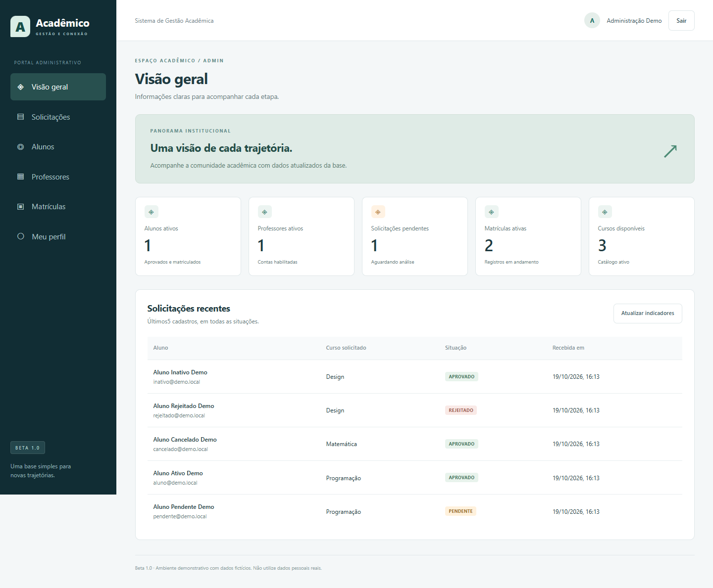

# Sistema de Gestão Acadêmica

Aplicação full stack para gerenciar solicitações de ingresso, alunos, professores e matrículas. O projeto reúne uma API REST em Java e uma interface web em React, com acesso separado para administração, professores e alunos.

A versão **Beta 1.0** concentra o fluxo acadêmico no cadastro, na análise da solicitação e no acompanhamento da matrícula. A execução é local, com dados demonstrativos e banco em memória.



## Acesso rápido ao sistema

Após [iniciar o backend e o frontend](#executar-localmente), abra o portal em **[http://127.0.0.1:5173](http://127.0.0.1:5173)**.

| Perfil | E-mail | Senha |
|---|---|---|
| Administrador | `admin@demo.local` | `Demo@12345` |
| Professor | `professor@demo.local` | `Demo@12345` |
| Aluno com matrícula ativa | `aluno@demo.local` | `Demo@12345` |

As contas são fictícias e destinadas à demonstração local. Para testar outros estados de cadastro e matrícula, consulte [todas as contas demonstrativas](#contas-demonstrativas). Os dados são recriados ao reiniciar o backend.

## Proposta do projeto

O sistema organiza o ingresso do aluno sem confundir cadastro com matrícula: a solicitação passa pela administração antes de gerar um vínculo acadêmico. Cada perfil acessa apenas as informações e operações previstas para sua função.

O escopo é uma demonstração técnica de gestão acadêmica, com regras de negócio no backend, autenticação e uma interface integrada à API. Não se trata de uma plataforma pronta para produção.

## Funcionalidades

| Perfil | Recursos |
|---|---|
| Administração | Painel de indicadores, análise de solicitações, gestão de alunos e professores, vínculo de professores a cursos e gestão de matrículas. |
| Professor | Consulta dos cursos vinculados e dos alunos autorizados. |
| Aluno | Cadastro com escolha de curso, consulta da solicitação e da matrícula e edição dos próprios dados quando aprovado e com matrícula ativa. |

### Fluxo de ingresso

1. O candidato se cadastra e seleciona um curso disponível.
2. A solicitação fica pendente de análise.
3. A administração aprova ou rejeita a solicitação.
4. A aprovação cria a matrícula no curso solicitado, na mesma transação.
5. O aluno acompanha sua situação pelo portal.

Cada aluno pode ter apenas um registro de matrícula. O cancelamento mantém a solicitação como aprovada e não permite rematrícula. A exclusão de alunos é lógica e fica bloqueada enquanto houver matrícula ativa.

## Tecnologias e organização

| Camada | Tecnologias |
|---|---|
| Backend | Java 21, Spring Boot 3.5.16, Spring Web, Spring Data JPA e Bean Validation |
| Segurança | Spring Security, JWT e BCrypt |
| Banco de dados | H2 em memória |
| Frontend | React, TypeScript, Vite e CSS próprio |
| Documentação da API | OpenAPI e Swagger UI |
| Testes | JUnit, Mockito, MockMvc, JaCoCo e Playwright |

O backend segue uma organização em camadas: controllers expõem os endpoints, serviços concentram as regras de negócio e repositórios fazem o acesso aos dados. Os DTOs separam os contratos da API das entidades persistidas.

```text
sistema-gestao-academica/
├── backend/     # API REST, regras de negócio e testes Java
├── frontend/    # Interface web e testes de integração com a API
├── docs/        # Requisitos, modelo de dados e documentação técnica
└── scripts/     # Verificação da documentação
```

## Executar localmente

### Pré-requisitos

- JDK 21 disponível no `PATH` ou configurado em `JAVA_HOME`.
- Node.js 24 e npm 11, versões usadas no ambiente documentado do projeto.
- Git para clonar o repositório.
- Acesso à internet para baixar dependências na primeira execução.

O Maven Wrapper está incluído no repositório. Não é necessário instalar Maven globalmente nem usar Docker.

```sh
git clone https://github.com/andres29582/sistema-gestao-academica.git
cd sistema-gestao-academica
```

### 1. Backend

Em um terminal PowerShell, a partir da raiz do projeto:

```powershell
Set-Location .\backend
.\mvnw.cmd spring-boot:run
```

No Linux ou macOS:

```sh
cd backend
sh mvnw spring-boot:run
```

### 2. Frontend

Em outro terminal, a partir da raiz do projeto:

```sh
cd frontend
npm ci
npm run dev
```

Nas próximas execuções, basta usar `npm run dev`. Execute `npm ci` novamente quando as dependências ou o arquivo `package-lock.json` mudarem.

### 3. Acesso

| Serviço | Endereço |
|---|---|
| Portal web | [http://127.0.0.1:5173](http://127.0.0.1:5173) |
| API REST | [http://127.0.0.1:8080](http://127.0.0.1:8080) |
| Swagger UI | [http://127.0.0.1:8080/swagger-ui/index.html](http://127.0.0.1:8080/swagger-ui/index.html) |

O Vite encaminha as chamadas de `/api` para o backend local. Para explorar o painel administrativo, entre com `admin@demo.local` e a senha `Demo@12345`.

Mantenha os dois terminais abertos durante o uso. Para encerrar, pressione `Ctrl+C` em cada um.

**Os dados não são persistentes:** ao encerrar o backend, as alterações são descartadas. A próxima inicialização recria a base demonstrativa.

## Contas demonstrativas

Todas as contas usam a senha **`Demo@12345`**. As credenciais e os dados são fictícios, destinados exclusivamente à demonstração local.

| E-mail | Cenário |
|---|---|
| `admin@demo.local` | Administração |
| `professor@demo.local` | Professor vinculado a Programação e Matemática |
| `professor.inativo@demo.local` | Professor desativado, com login bloqueado |
| `pendente@demo.local` | Aluno com solicitação pendente |
| `aluno@demo.local` | Aluno aprovado com matrícula ativa |
| `cancelado@demo.local` | Aluno aprovado com matrícula cancelada, sem edição dos próprios dados |
| `rejeitado@demo.local` | Aluno com solicitação rejeitada, sem edição dos próprios dados |
| `inativo@demo.local` | Aluno desativado, com login bloqueado |

Não utilize dados pessoais reais nem exponha o ambiente demonstrativo à internet.

## Autenticação e configuração

A autenticação utiliza JWT com validade de 15 minutos. O token permanece apenas na memória do navegador: recarregar a página exige um novo login. Contas desativadas não conseguem entrar, e a API também verifica se a conta continua habilitada nas requisições autenticadas.

| Variável | Uso |
|---|---|
| `APP_DEMO` | Habilita a carga demonstrativa; o padrão é `true`. Com `false`, a carga não é criada. |
| `APP_JWT_SEGREDO` | Define a chave JWT em Base64, com pelo menos 32 bytes aleatórios. Sem configuração, uma chave é gerada a cada inicialização. |
| `SERVER_ADDRESS` | Define a interface de rede do backend; o padrão local é `127.0.0.1`. |

Segredos não devem ser versionados. Desabilitar a carga demonstrativa não transforma o H2 em um banco persistente.

## Testes e verificações

### Backend

Dentro de `backend/`, execute:

```powershell
.\mvnw.cmd verify
```

No Linux ou macOS, use `sh mvnw verify`. Os relatórios são gerados em `backend/target/surefire-reports/` e `backend/target/site/jacoco/`.

A documentação registra uma execução com **52 testes aprovados**. Os resultados e os cenários cobertos estão em [evidências do backend](docs/evidencias-backend.md).

### Frontend integrado à API

Os testes Playwright iniciam o backend pelo JAR e o servidor Vite. Antes da execução:

- Configure `JAVA_HOME` com o caminho do JDK 21; o script usa essa variável para localizar o Java.
- Compile o JAR em `backend/` com `.\mvnw.cmd package` ou `sh mvnw package`.
- Deixe livres as portas `8080`, `5173` e `18081`, encerrando as instâncias iniciadas manualmente.

Em `frontend/`, com as dependências instaladas:

```sh
npx playwright install chromium
npm test
```

Para utilizar um navegador já instalado, defina `PLAYWRIGHT_CHROMIUM_EXECUTABLE` com o caminho completo do executável, em vez de instalar o Chromium do Playwright.

Para verificar o TypeScript e gerar os arquivos de distribuição:

```sh
npm run build
```

Os arquivos são gerados em `frontend/dist/`. O comando `npm run preview` permite pré-visualizar essa distribuição, mas não substitui a integração com o backend. Consulte os cenários registrados em [evidências do frontend](docs/evidencias-frontend.md).

### Verificação do JAR

O script `backend/scripts/verificar-execucao.ps1` verifica a execução e o reinício do backend. No Windows, com PowerShell 7, a partir da raiz:

```powershell
.\backend\scripts\verificar-execucao.ps1 -JavaHome "<caminho-do-JDK-21>"
```

O roteiro utiliza a porta `18080` e encerra os processos que inicia. O resultado registrado está em [resultado do smoke](docs/resultado-smoke.json).

## Docker

O repositório inclui um Dockerfile para o backend. O build e a execução do container ainda precisam de validação; essa opção não é necessária para o uso local descrito acima.

```sh
docker build -t academico-beta ./backend
docker run --rm --name academico-beta -p 127.0.0.1:8080:8080 academico-beta
```

Para encerrar, em outro terminal:

```sh
docker stop academico-beta
```

O container inclui apenas a API e o Swagger; o frontend é executado separadamente. O backend escuta em `0.0.0.0` dentro do container, enquanto a publicação de porta acima restringe o acesso ao host local. O H2 permanece em memória, mesmo com um volume montado.

## Escopo e limitações

Esta versão não inclui notas, frequência, calendário, materiais didáticos, CRUD de cursos, rematrícula ou recuperação de senha. Também não inclui um módulo de exclusão de dados pessoais nem certificação de conformidade com a LGPD.

A base em memória e as contas demonstrativas foram adotadas para facilitar a avaliação local. Uso em produção exige outro planejamento de persistência, segurança e operação. Não há comprovação de desempenho sob carga, auditoria completa de acessibilidade WCAG ou validação do container.

## Documentação

- [Índice da documentação](docs/README.md)
- [Requisitos](docs/requisitos.md)
- [Regras de negócio](docs/regras-negocio.md)
- [Modelo de dados](docs/modelo-dados.md)
- [Contratos da API](docs/contratos-api.md)
- [Decisões técnicas e limites](docs/decisoes.md)
