# 15 casos de uso — fluxos vigentes

Fluxogramas verticais (`flowchart TD`). Erros seguem [ProblemDetail e códigos REST](contratos-api.md). Conta bloqueada recebe 401; perfil/propriedade incorretos recebem 403. A interface orienta, mas a API é a autoridade das permissões.

## UC-001 — Solicitar cadastro de aluno
Visitante informa nome, e-mail, telefone, senha e curso ativo. A transação cria Usuario ALUNO e Aluno PENDENTE, sem matrícula. Campos inválidos 400, e-mail duplicado 409, sem efeitos parciais.
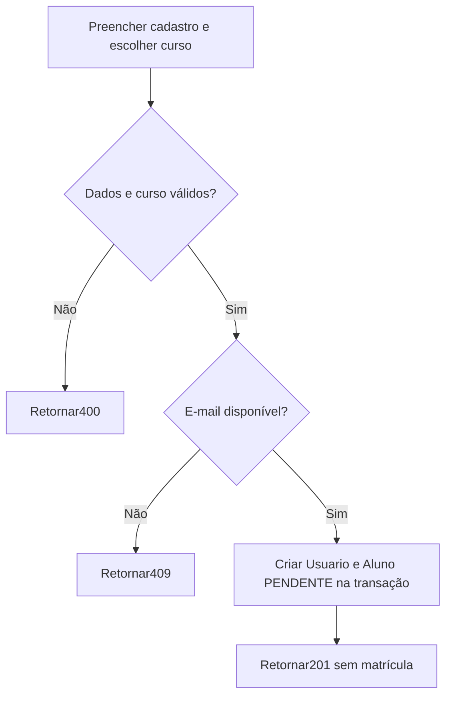
## UC-002 — Autenticar usuário
Qualquer usuário com credenciais válidas e conta habilitada recebe JWT de 15 min. Credenciais incorretas, conta excluída/desativada401; formato inválido 400. Papel não vem do cliente. Requisições posteriores revalidam conta e papel no banco.
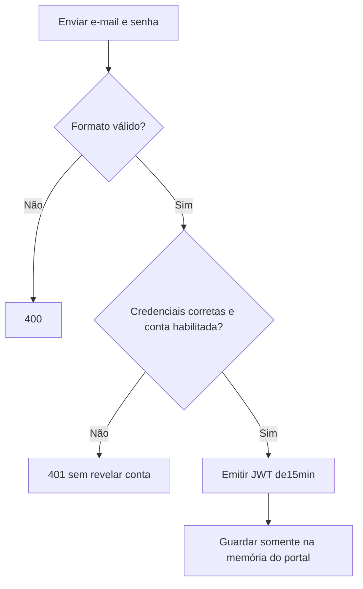
## UC-003 — Atualizar dados pessoais
Usuário altera nome, e-mail e telefone próprios. ADMIN/PROFESSOR habilitados podem editar; ALUNO somente APROVADO com matrícula ATIVA. Papel/situação não são campos aceitos. E-mail duplicado 409.
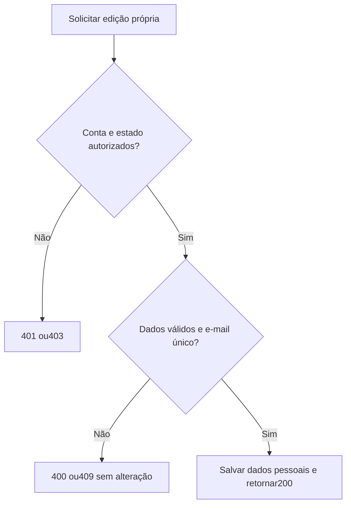
## UC-004 — Consultar situação da solicitação
ALUNO habilitado lê sua própria solicitação, inclusive PENDENTE/REJEITADO ou aprovado com matrícula cancelada. A consulta não muda estado nem cria matrícula.
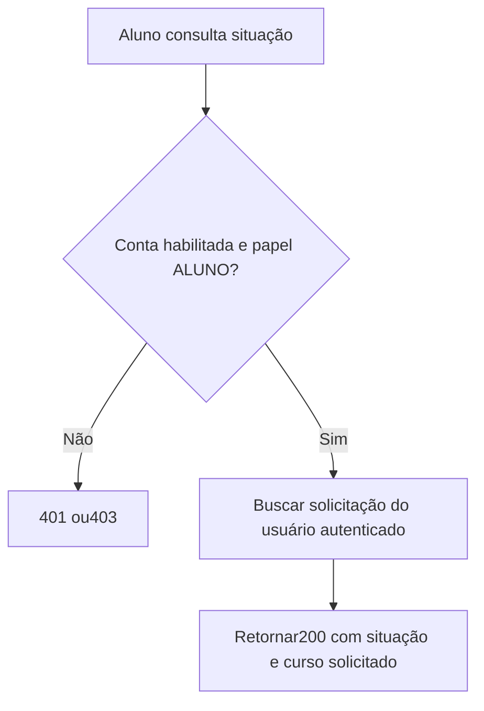
## UC-005 — Consultar matrícula
ALUNO consulta somente sua matrícula. Ausente 404; ativa/cancelada200 com datas. Cancelamento não bloqueia essa leitura se a conta continuar habilitada.
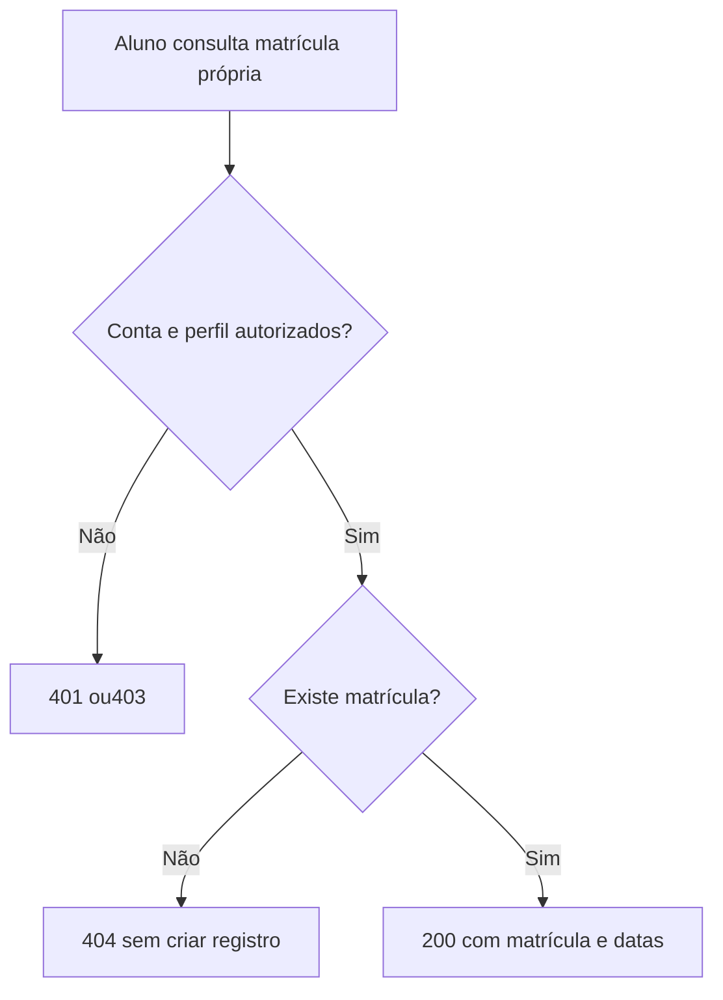
## UC-006 — Analisar solicitações
ADMIN lista pendentes não excluídos e consulta detalhe pelo ID do Aluno. Inatividade da conta não apaga a solicitação. Consultar não aprova/rejeita implicitamente.
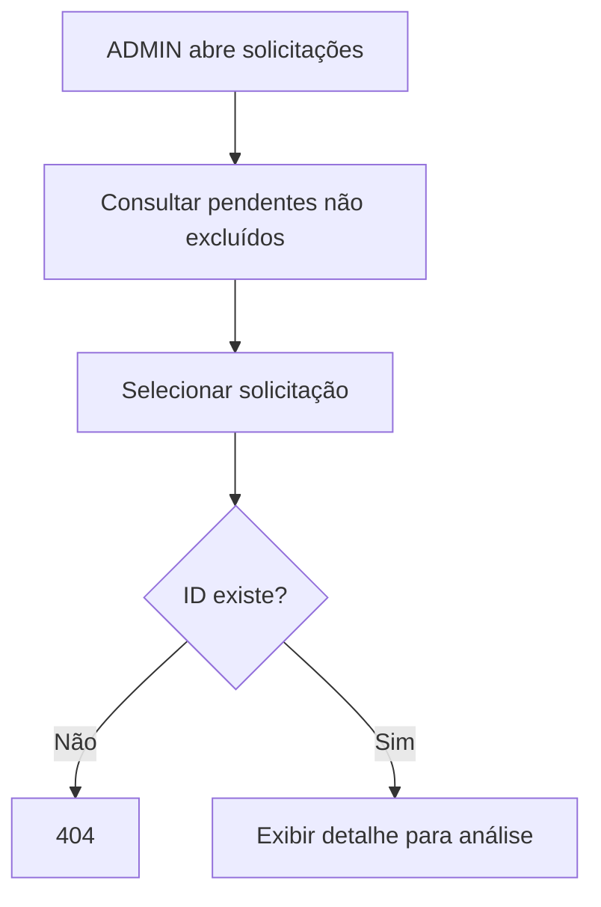
## UC-007 — Aprovar solicitação e gerar matrícula
ADMIN aprova somente PENDENTE. Mesma transação/lock no Aluno muda APROVADO e insere matrícula ATIVA no curso solicitado ativo. UNIQUE vitalício impede duplicidade; falha causa rollback integral.
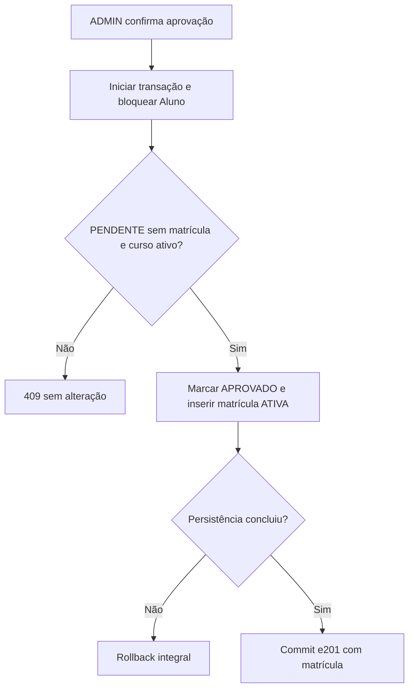
## UC-008 — Rejeitar solicitação
ADMIN rejeita PENDENTE na transação com lock do Aluno. Define REJEITADO sem matrícula. Repetição ou solicitação já decidida 409; ID desconhecido 404.
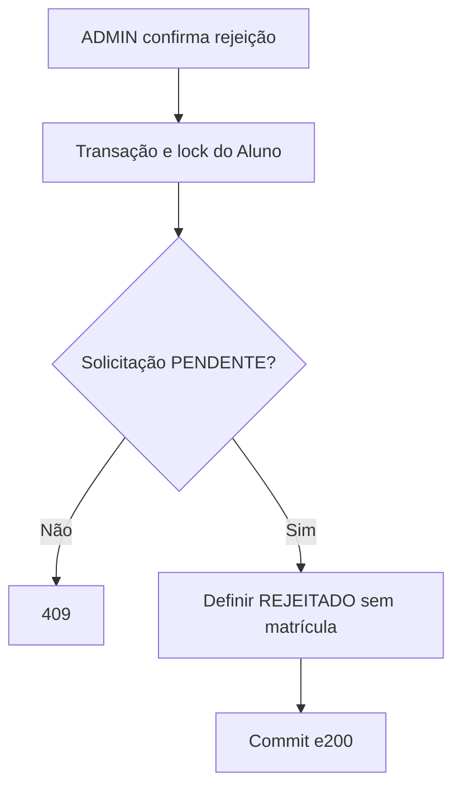
## UC-009 — Gerenciar alunos
ADMIN lê, altera dados pessoais, ativa/desativa e exclui logicamente. Cadastro inicial é UC-001, não outro formulário administrativo. Matrícula ATIVA bloqueia exclusão 409; cancelada/ausente permite preservar registros, marcar exclusão e bloquear conta 204.
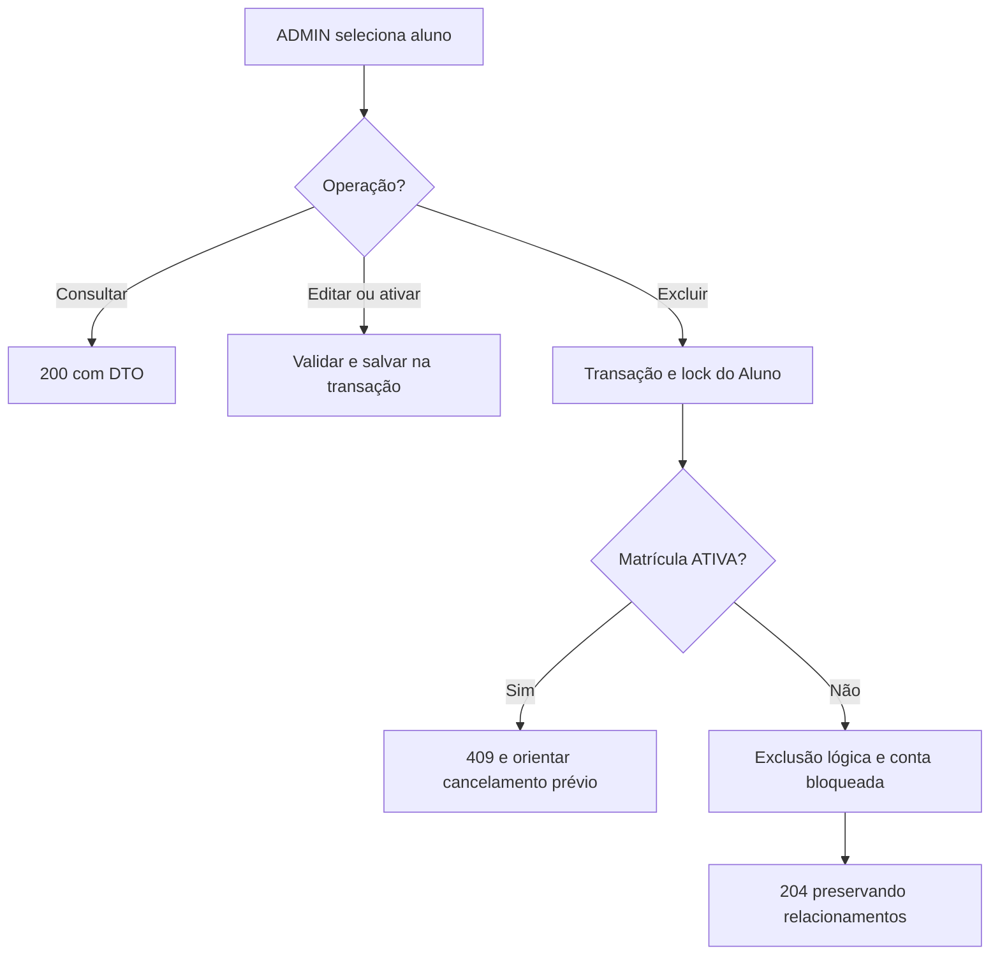
## UC-010 — Gerenciar professores
ADMIN cria/consulta/edita/ativa/desativa/exclui logicamente. Cursos mínimos 1, IDs únicos e existentes. Novos vínculos inativos são inválidos; vínculo antigo inativo pode permanecer. PUT com cursoIds define conjunto final; omissão preserva. Professor e associações são atômicos.
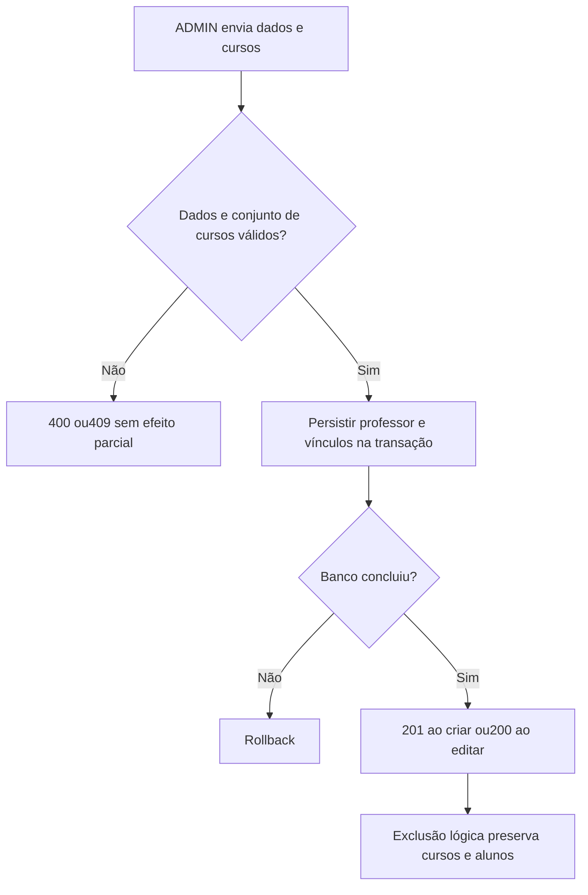
## UC-011 — Gerenciar matrículas
ADMIN lista/consulta e altera curso de matrícula ATIVA para outro curso existente/ativo. Preserva ID, curso solicitado e registro único. Matrícula cancelada não pode ser reativada/editada. Cancelamento detalhado em UC-015.
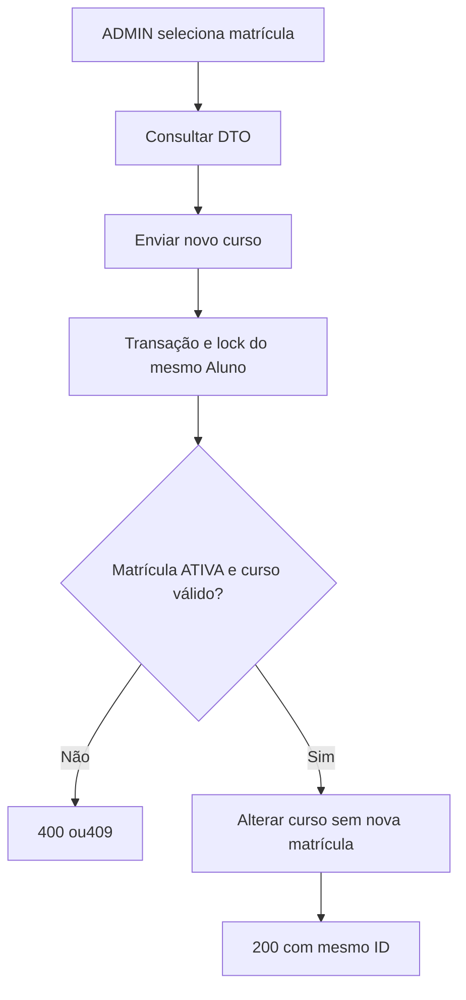
## UC-012 — Consultar indicadores administrativos
ADMIN consulta contagens reais do banco e últimos 5 cadastros, ordenados por criadoEm/id descendentes. As fórmulas distinguem matrícula ativa de conta habilitada; não há números simulados.
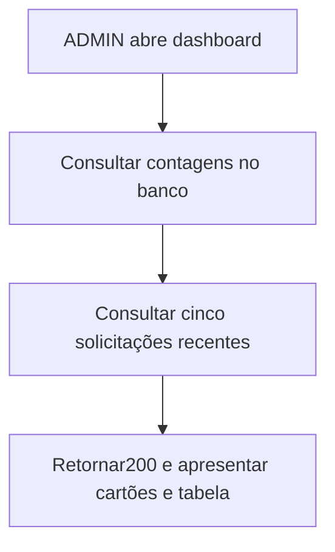
## UC-013 — Consultar cursos atribuídos ao professor
PROFESSOR habilitado consulta seus próprios vínculos, inclusive curso antigo inativo se ainda atribuído. Não recebe operação de criação/alteração do catálogo ou dos vínculos.
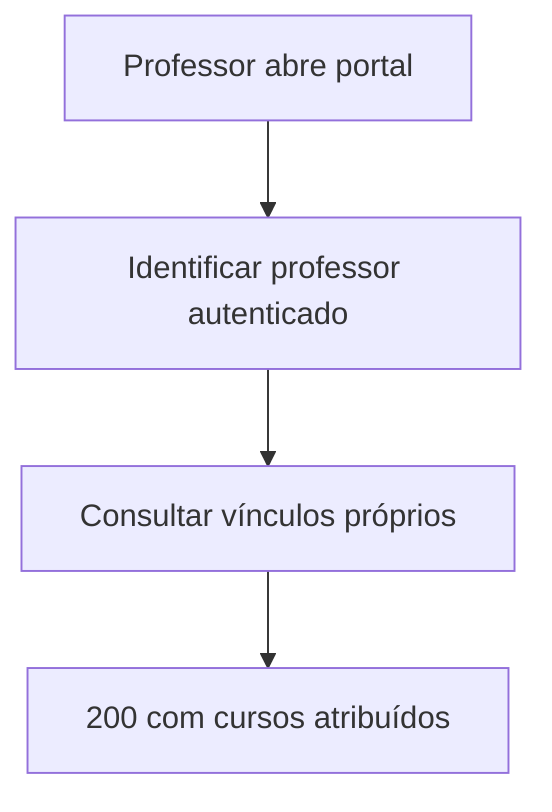
## UC-014 — Consultar alunos dos cursos
PROFESSOR consulta curso próprio; alheio 403. Resultado contém apenas alunos habilitados/não excluídos com matrícula ATIVA naquele curso e campos mínimos alunoId/nome/matriculaId.
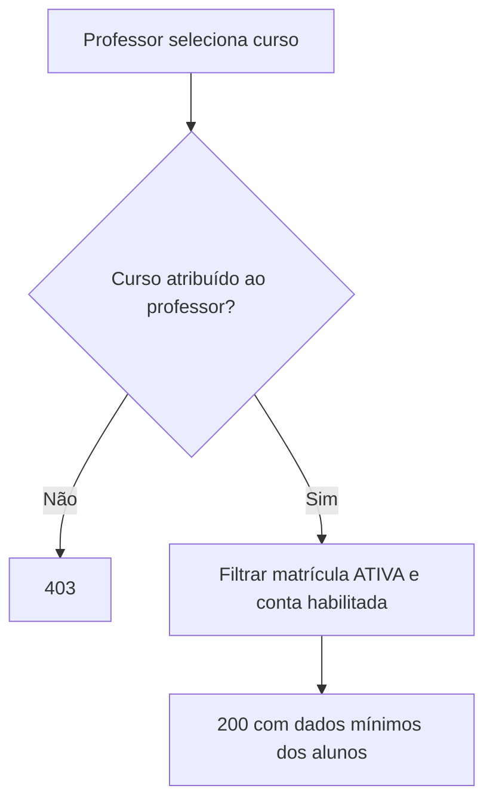
## UC-015 — Cancelar matrícula
ADMIN confirma cancelamento de matrícula ATIVA. Mesmo lock/transação do Aluno; preenche canceladoEmUTC, define CANCELADA e preserva APROVADO e registros. Repetição 409; sucesso 204. Consulta própria continua, edição acadêmica/pessoal fica restrita; rematrícula fora do escopo.
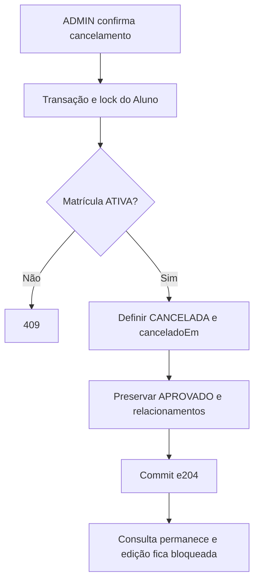
