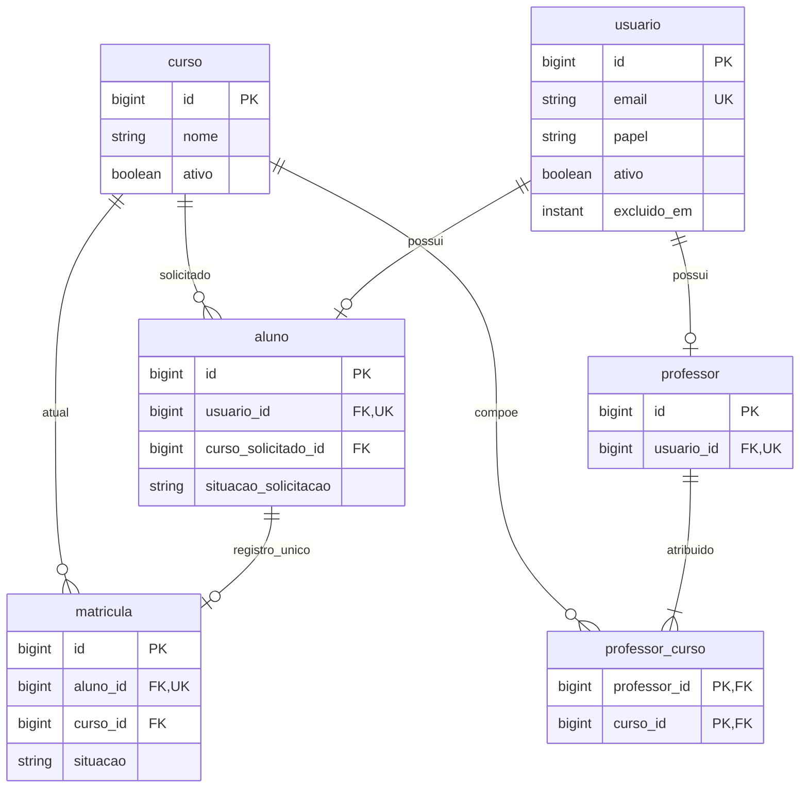
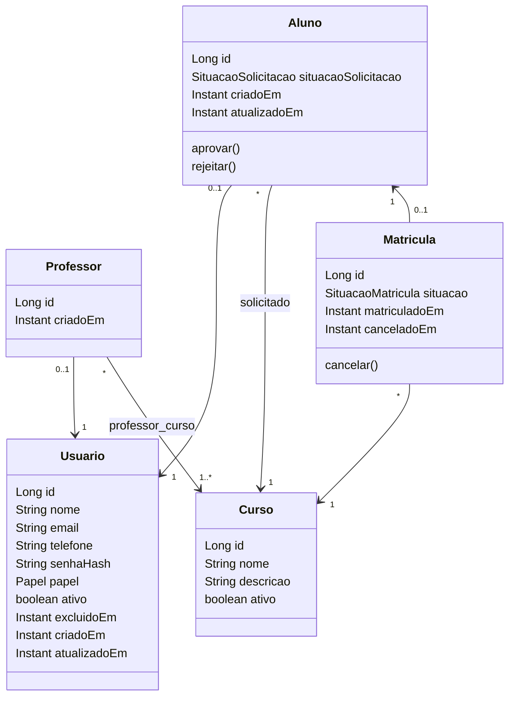

# Modelo implementado — seis tabelas

Hibernate cria o esquema no início; H2 reside em memória e é descartado no encerramento. PKs de entidades são `Long`/BIGINT geradas por IDENTITY; enums são STRING e eventos `Instant`/UTC. DTOs separam API e persistência. Não existe tabela Administrador nem tabela de token.

## DER

## Dicionário

| Tabela | Campos e restrições |
|---|---|
| usuario | `id` PK; `nome` obrigatório até 120; `email` obrigatório até 254, UNIQUE global normalizado; `telefone` obrigatório até 30; `senha_hash` obrigatório, nunca exposto; `papel` ADMIN/PROFESSOR/ALUNO; `ativo` boolean; `excluido_em` Instant opcional; `criado_em`, `atualizado_em` obrigatórios. |
| aluno | `id` PK; `usuario_id` FK/UNIQUE obrigatório; `curso_solicitado_id` FK obrigatório; `situacao_solicitacao` PENDENTE/APROVADO/REJEITADO; `criado_em`, `atualizado_em` Instant obrigatórios. |
| professor | `id` PK; `usuario_id` FK/UNIQUE obrigatório; `criado_em` Instant obrigatório. |
| curso | `id` PK; `nome`, `descricao` obrigatórios; `ativo` boolean obrigatório. Catálogo carregado no seed; CRUD fora do escopo. |
| matricula | `id` PK; `aluno_id` FK/UNIQUE vitalício; `curso_id` FK; `situacao` ATIVA/CANCELADA; `matriculado_em` Instant obrigatório; `cancelado_em` opcional, preenchido ao cancelar e nunca anterior à matrícula. |
| professor_curso | `professor_id` e `curso_id` FKs obrigatórias; PK composta impede duplicados. Retirar vínculo não exclui entidades associadas. Não possui entidade Java própria. |

As entidades não compartilham herança JPA. Contas inativas podem ter matrícula ativa: as situações são dimensões diferentes. `excluido_em` é exclusão lógica de conta, não remoção física nem procedimento LGPD. A restrição de professor com ao menos um curso é validada pelo Service; o DER não substitui essa regra transacional.

## Classes de domínio

## Camadas e consistência

`controlador/` valida contrato e HTTP; `servico/` concentra regras e transações; `repositorio/` acessa JPA; `dominio/` mantém estado; `dto/` define requisições/respostas; `seguranca/` revalida conta e papel. Aprovação/rejeição/cancelamento/alteração/exclusão de aluno compartilham lock pessimista no Aluno; IDs são buscados sem materializar entidades antes do lock. UNIQUE é exercitado por SQL real; rollback e duas transações concorrentes possuem testes, não inferências.
